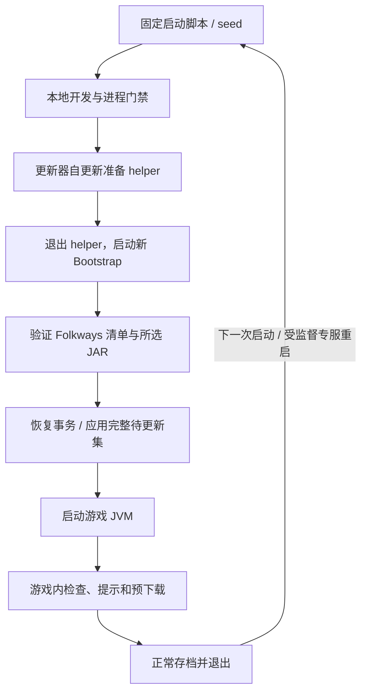

<p align="center"></p>

<h1 align="center">Folkways Updater</h1>

<p align="center">在启动前准备更新，在开发时保护你的本地构建。</p>

<p align="center">
  <a href="https://github.com/davisye/update-folkways/actions/workflows/ci.yml"></a>
  
  
  <a href="LICENSE"></a>
</p>

<p align="center">
  <a href="#快速开始">快速开始</a> ·
  <a href="https://github.com/davisye/update-folkways/releases">下载</a> ·
  <a href="docs/configuration.md">配置</a> ·
  <a href="docs/publishing.md">发布镜像</a> ·
  <a href="docs/plan.md">路线图</a> ·
  <a href="#english">English</a>
</p>

独立的 Java Bootstrap 与 NeoForge 1.21.1 伴随 Mod，面向 [Folkways](https://github.com/IzakyL/folkways) 开发版。Bootstrap 在创建游戏 JVM **之前**处理受管 JAR；伴随 Mod 在游戏中轮询、提示和预下载，准备下一次启动。无需修改 Folkways 源码。

> **开发预览。** 默认 `localDevelopment=true`，不会自动下载或替换本地开发产物。Folkways 的 Ed25519 签名发布工具已提供，但公共自动签名通道尚未上线；仅安装本项目不会让现有 GitHub JAR 自动成为可信更新。

## 为什么做这个

开发版更新频繁，而启动后的 Mod 已经可能被加载器打开。这个项目把文件替换放到外部启动门禁中，再让游戏内的检查提前完成下载。你可以继续保留 Core + Vanilla 的轻量安装，也可以选择需要的扩展，同一次更新始终来自同一构建。

| 能力 | 当前行为 |
| --- | --- |
| 启动前更新 | 独立进程先校验、恢复事务和替换，再启动真实游戏 JVM |
| 游戏内检查 | 定时轮询、提示、预下载；运行中的游戏不替换 JAR |
| 源与通道 | `IzakyL/folkways` / `davisye/folkways`；release、rc、beta、alpha、nightly |
| 按需模块 | Core、Vanilla 必选；Create、Modular Golems、Cookery 可选 |
| 国内网络 | GitHub 与 `github.davisye.cn` 故障切换；新配置默认镜像优先 |
| 本地开发保护 | 配置、环境变量、JVM 参数、标记文件与 NeoForge 开发环境保护 |
| 更新器自身更新 | 独立官方发布通道；固定 seed 在退出旧 helper 后启动新 Bootstrap |
| 停止与重启 | OP 4、可取消倒计时、正常存档；专服由 supervisor 验证后重启 |

## 工作方式



`ITransformationService.onLoad` 不能保证早于 mods 中所有 JAR 的探查和打开，因此本项目没有使用 ModLauncher SPI 原地抢先替换。实现依据见 [启动顺序与信任边界](docs/audit.md)。

Windows 无法用一次文件系统操作原子覆盖多个 JAR。本项目采用**逐文件原子替换、恢复日志、旧文件备份及启动门禁**，事务完成或恢复成功后才继续受监督启动。跨文件原子性和断电持久性不在当前承诺内。

## 快速开始

需要 Java 21，以及独立的 NeoForge 1.21.1 测试实例。先关闭实例，并备份世界与配置。

### 1. 获取同一版本的文件

从 [Releases](https://github.com/davisye/update-folkways/releases) 选择 [nightly](https://github.com/davisye/update-folkways/releases/tag/nightly) 或正式版本，下载同一次发布的文件：

| 文件 | 用途 |
| --- | --- |
| `folkways-bootstrap-<version>-standalone.jar` | 独立启动程序 |
| `folkways-updater-neoforge-1.21.1-<version>.jar` | 伴随 Mod，放入实例的 `mods/` |
| `launch.ps1` / `launch.sh` | 对应系统的固定启动 seed，首次手动安装 |
| `checksums.sha256` | 发布资产校验值 |
| `update-metadata.json` | 更新器自身更新的构建与资产元数据 |

国内首次下载可先浏览官方 Release 确认版本，再用同附件镜像：[launch.ps1](https://github.davisye.cn/_github/github.com/davisye/update-folkways/releases/download/nightly/launch.ps1)、[launch.sh](https://github.davisye.cn/_github/github.com/davisye/update-folkways/releases/download/nightly/launch.sh)、[update-metadata.json](https://github.davisye.cn/_github/github.com/davisye/update-folkways/releases/download/nightly/update-metadata.json)。两个 JAR 的版本化文件名以同次官方发布/元数据为准，镜像形态为 `https://github.davisye.cn/_github/github.com/davisye/update-folkways/releases/download/nightly/<附件名>`。首次安装仍是人工信任步骤；镜像不能代替官方 API 摘要与 CI 校验，也不应混用不同发布的文件。

seed 的安装和完整参数见 [安装与自更新](docs/installation.md)。它只监督你提供的前台游戏 JVM；客户端仍需由能提供有效启动参数、账号和会话的启动器接入。

### 2. 初始化配置

```powershell
java -jar <bootstrap.jar> init --game-dir <instance>
java -jar <bootstrap.jar> status --game-dir <instance>
```

共享配置位于 `<instance>/.folkways-updater/config.json`。本地编译时保留 `localDevelopment: true`；这同时阻止 Folkways 更新与更新器自身更新。需要受管更新的测试实例再显式关闭它。

只启用更新器自身更新时，可设置 `localDevelopment=false`、`selfUpdateEnabled=true`，Folkways 的 `manifestUrl` / `publicKeys` 保持空值。无需先配置 Folkways 签名或接管其文件。

### 3. 可选：启用 Folkways 更新通道

配置 `repository`、`channel`、`modules`，并从可信发布者取得 `manifestUrl` 与预先信任的 `publicKeys`。首次接管已安装的 Folkways JAR，需要在确认实例关闭、模块正确后执行：

```powershell
java -jar <bootstrap.jar> adopt --game-dir <instance>
```

`adopt` 只记录现有文件及哈希。它不会下载、替换文件，也不会把未知下载源加入信任。人工改写或重新编译的受管 JAR 与记录不符时，替换会停止。完整字段与操作顺序见 [配置指南](docs/configuration.md)。

## 本地编译优先

以下任一条件启用开发保护；操作前会重查，下载过程中开启保护也会阻止安装：

- 配置 `localDevelopment=true`，这是默认值。
- JVM 参数 `-Dfolkways.localDevelopment=true`。
- 环境变量 `FOLKWAYS_LOCAL_DEVELOPMENT=true`。
- 存在 `.folkways-updater/LOCAL_DEVELOPMENT` 文件。
- 伴随 Mod 检测到 NeoForge 非生产开发环境。

更新器源码构建缺少官方 CI 构建身份时，也不会被官方自更新自动覆盖。开发模式不会自动撤销已安装版本；它阻止后续自动更新。

## 两条更新通道，各有信任来源

**Folkways Mod 更新**使用预置信任的 Ed25519 公钥，检查源仓库、游戏版本、通道、构建、单调序号，以及每个 JAR 的大小、SHA256 和 modId。只下载选中的模块，全部完成后才提交待安装集合。

**更新器自身更新**固定来自本仓库 `davisye/update-folkways`。信任依据严格从官方 GitHub HTTPS API 直连获取，核对发布资产摘要与成功的官方 CI 构建；API 获取失败时保留旧版继续启动。清单文件与二进制可经镜像下载，仍按官方摘要验字节。它不依赖未上线的 Folkways 签名通道。seed 协议 v1 首次手动安装，seed 脚本本身不自动替换；旧式直接 `java -jar` 启动只预下载自身更新并提示迁移。详见 [安装与自更新](docs/installation.md)、[CI 与发布](docs/ci.md)。

## 网络与镜像

新配置默认 `mirror-first`；也可选 `direct-first` 或 `region`。`region` 读取本地 `regionHint`，`CN` 优先镜像，不进行自动 IP 定位。镜像超时、状态异常、坏摘要或无效签名时会尝试允许的备用路由。

代理使用 `https://github.davisye.cn/_github/github.com/<owner>/<repo>/...` 格式。OpenList 可在 [pan.davisye.cn](https://pan.davisye.cn/) 按仓库、游戏版本和通道展示发布目录。链接目录不等于二进制长期存储；归档保证与接入约束见 [发布镜像指南](docs/publishing.md)。

## 游戏内命令

所有命令需要 OP 4。`/shutdown`、`/restart` 还要求 `commandsEnabled=true`，默认关闭；已有同名生命周期命令不会被覆盖。状态与检查命令不受该开关限制，但检查仍遵守本地开发保护。

| 命令 | 行为 |
| --- | --- |
| `/folkwaysupdate status` | 查看当前状态 |
| `/folkwaysupdate check` | 请求检查和预下载 |
| `/shutdown [seconds]` | 倒计时后走正常停止与存档流程；集成服务器随后关闭客户端 |
| `/restart [seconds]` | 仅重启由本项目 supervisor 管理的专用服务器 |
| `/shutdown cancel` / `/restart cancel` | 在停止请求发出前取消倒计时 |

命令作用于当前服务器；远程多人客户端自己的本地更新由客户端轮询处理。倒计时默认 10 秒，范围 0–300 秒。专服重启要求有效的 supervisor 身份、存活进程、一次性请求和正常退出，并受次数与冷却限制。没有 supervisor 时拒绝重启并保持服务器运行。**客户端完整重启暂未实现**；集成服务器拒绝 `/restart`，避免把重启存档误认为重新加载客户端 Mod。

## 开发与验证

```powershell
.\gradlew.bat build --console=plain
python -m unittest discover -s tests/publisher -v
```

Linux 使用 `./gradlew build --console=plain`。需要 Java 21 JDK、Python 3.11+；首次构建会下载 Gradle 与依赖。自更新相关测试与 CI 命令见 [贡献指南](CONTRIBUTING.md)。

[CI](https://github.com/davisye/update-folkways/actions/workflows/ci.yml) 在 Windows/Linux 构建并验证，然后才允许可信主分支或版本 tag 发布。离线测试、真实专服测试及尚未覆盖的客户端边界见 [验证说明](docs/verification.md)。本项目不把单元测试通过等同完整 Folkways 模组包或所有启动器已验证。

## 继续阅读

- [安装与自更新](docs/installation.md) · [配置](docs/configuration.md)
- [发布、归档与 OpenList](docs/publishing.md) · [CI](docs/ci.md)
- [架构与约束](docs/audit.md) · [验证](docs/verification.md) · [路线图](docs/plan.md)
- [贡献](CONTRIBUTING.md) · [安全问题](SECURITY.md) · [变更记录](CHANGELOG.md)

遵循 [MIT 许可证](LICENSE)。第三方依赖见 [THIRD_PARTY.md](THIRD_PARTY.md)。本项目是独立开发工具，未与 Minecraft、NeoForge 或 Folkways 上游建立官方隶属关系。

## English

Folkways Updater is an external Java 21 Bootstrap and a NeoForge 1.21.1 companion mod. It prepares and verifies updates before the game JVM starts, while the companion checks and stages downloads for the next launch. Local development is protected by default.

Choose the upstream or fork, a release channel, and optional modules. Dedicated server restart uses a verified supervisor and normal save/shutdown flow; full client restart remains unsupported. Folkways updates require a trusted signed manifest, whose public automated publishing is not yet enabled. Updater self-updates use this repository's official GitHub release and CI metadata, with a manually installed stable seed.

Start with [Releases](https://github.com/davisye/update-folkways/releases), [installation](docs/installation.md), and [configuration](docs/configuration.md). Contributions and security reports are welcome through the linked project guides.
