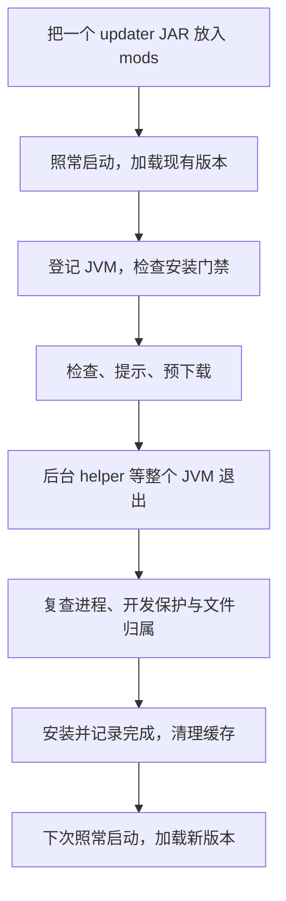

<p align="center"></p>

<h1 align="center">Folkways Updater</h1>

<p align="center">放入一个 Mod，更新留给退出之后。</p>

<p align="center">
  <a href="https://github.com/davisye/update-folkways/actions/workflows/ci.yml"></a>
  
  
  <a href="LICENSE"></a>
</p>

<p align="center">
  <a href="#快速开始">快速开始</a> ·
  <a href="https://github.com/davisye/update-folkways/releases">下载</a> ·
  <a href="docs/configuration.md">配置</a> ·
  <a href="docs/verification.md">验证范围</a> ·
  <a href="docs/plan.md">路线图</a> ·
  <a href="#english">English</a>
</p>

面向 [Folkways](https://github.com/IzakyL/folkways) 开发版的独立 NeoForge 1.21.1 更新器。**新安装只需一个 Mod JAR**：运行时检查、提示和预下载，后台 helper 等整个游戏 JVM 退出后安装，下次启动加载新版本。无需手动安装 Bootstrap、启动脚本、更新元数据或密钥。

> **开发预览。** 第一次运行加载你已安装的版本；更新准备给后续启动，不承诺每次启动前一定是最新。官方新安装可自动更新本更新器；Folkways 的公共自动签名通道仍延期，未配置其可信清单时不会替换 Folkways JAR。

## 快速开始

1. 安装 Java 21 与 NeoForge 1.21.1，关闭准备使用的实例。
2. 从 [Releases](https://github.com/davisye/update-folkways/releases) 下载 **`folkways-updater-neoforge-1.21.1-<version>.jar`**，放进实例 `mods/`。只保留一份 updater。
3. 照常用你的启动器启动游戏。第一次会检查和预下载；正常退出后，让后台 helper 完成安装，下次启动使用新版本。

更新 helper 已包含在 Mod 内，会自动释放到实例的 `.folkways-updater/`。不必更换启动器或复制额外脚本。本项目不代装 Minecraft、NeoForge、Folkways 或扩展的前置 Mod。

国内可先在官方 Release 确认同次发布的 JAR 文件名，再使用同附件镜像：

```text
https://github.davisye.cn/_github/github.com/davisye/update-folkways/releases/download/nightly/<完整JAR文件名>
```

首次手工下载仍由你确认可信来源。镜像负责传输，自动更新的信任依据来自官方 GitHub API 与成功 CI 构建。具体安装、退出和异常恢复说明见 [安装指南](docs/installation.md)。已有 Bootstrap/seed 用户请看其中的 [旧方式迁移](docs/installation.md#旧-bootstrapseed-方式迁移)。

## 一次更新的节奏



运行中不覆盖已加载的 JAR。若你重开游戏恰好与安装重叠，安装门禁可能中止这次启动并提示重开，避免混代文件进入世界。Mod 构造阶段已经晚于部分加载器扫描；本项目不把这称为“扫描前更新”。[架构与边界](docs/audit.md) 说明了选择这个流程的原因。

## 保留本地开发的主动权

官方发行 JAR 在**没有现有配置**的新实例中默认启用管理更新（`localDevelopment=false`）。已有配置原值保留，不会把以前开启的开发保护改成关闭。

以下任一条件继续保护本地构建，不检查、预下载或替换：

- 配置 `localDevelopment=true`。
- JVM 参数 `-Dfolkways.localDevelopment=true`。
- 环境变量 `FOLKWAYS_LOCAL_DEVELOPMENT=true`。
- 存在 `.folkways-updater/LOCAL_DEVELOPMENT` 文件。
- NeoForge 非生产开发环境，或 updater 本身缺少官方 CI 构建身份。

helper 安装前也会重查保护。人工重新编译或修改过的受管 JAR 与归属记录不符时，替换会停止。完整说明见 [配置指南](docs/configuration.md)。

## 两条独立的更新通道

| 通道 | 信任与当前边界 |
| --- | --- |
| 更新器自身 | 固定 `davisye/update-folkways`；官方 API 的资产大小/SHA256、成功 `ci.yml` 构建、完整提交和 JAR 内构建身份一致才接受；无需配置 Folkways 签名密钥 |
| Folkways Mod | 可选 `IzakyL/folkways` 或 `davisye/folkways`；需要预置信任的 Ed25519 公钥和签名清单，公共自动签名发布仍未启用 |

Folkways 通道支持 release、rc、beta、alpha、nightly；Core、Vanilla 必选，Create、Modular Golems、Cookery 按需选择，同一次更新来自同一构建。`manifestUrl` / `publicKeys` 留空时，仅使用 updater 自身更新，不自动替换这些模块。

网络新配置默认 `mirror-first`，GitHub 下载与 [github.davisye.cn](https://github.davisye.cn/) 可故障切换。`region` 策略使用本地 `regionHint=CN`，不查询 IP 地域。自身更新的可信 API 信息严格直连官方 GitHub；API 不可用时保留现有版本。SHA256 校验不是数字签名。

[OpenList](https://pan.davisye.cn/) 可展示 Folkways 发布链接。nightly 只保留最新一套，其他渠道按版本归档；外链目录不等于持久二进制存储。发布工具和存储边界见 [发布镜像指南](docs/publishing.md)。

## 游戏内命令

命令需要 OP 4。状态和检查可用；停止/重启类命令还要求 `commandsEnabled=true`，默认关闭。

| 命令 | 行为 |
| --- | --- |
| `/folkwaysupdate status` | 查看状态 |
| `/folkwaysupdate check` | 手动请求后台检查和预下载，遵守开发保护 |
| `/shutdown [seconds]` | 默认 10 秒，范围 0–300 秒；正常停止和存档，集成服务器随后关闭客户端 |
| `/shutdown cancel` / `/restart cancel` | 停止请求发出前取消倒计时 |
| `/restart [seconds]` | 专服正常停止后，由 helper 重新启动整个 Java 进程；支持同样的倒计时与取消 |

Drop-in `/restart` 已在只安装 updater 的真实 NeoForge 专服中验证正常保存、整 JVM 重启、原世界重开，以及限额拒绝后保持运行。helper 或原始参数不可用时先拒绝请求；完整 Folkways 包、真实玩家及客户端尚未测试。完整客户端重启暂未接入启动器，不能用重启集成服务器代替。当前边界见 [验证说明](docs/verification.md)。

## 开发与验证

```powershell
.\gradlew.bat build --console=plain
python -m unittest discover -s tests/publisher -v
```

Linux 使用 `./gradlew`。需要 Java 21 JDK、Python 3.11+；首次构建会下载依赖。源码构建与 NeoForge 开发环境保持开发保护。[贡献指南](CONTRIBUTING.md) 说明如何使用隔离测试实例。

Windows/Linux [CI](https://github.com/davisye/update-folkways/actions/workflows/ci.yml)、实际单 JAR 安装验证、历史外部 seed 升级实验的范围分开记录在 [验证说明](docs/verification.md)，不把旧方式成功等同新方式已验收。

## 继续阅读

- [安装](docs/installation.md) · [配置](docs/configuration.md) · [架构](docs/audit.md)
- [验证](docs/verification.md) · [路线图](docs/plan.md) · [CI](docs/ci.md)
- [贡献](CONTRIBUTING.md) · [安全报告](SECURITY.md) · [变更记录](CHANGELOG.md)

遵循 [MIT 许可证](LICENSE)，第三方组件见 [THIRD_PARTY.md](THIRD_PARTY.md)。本项目是独立开发工具，未与 Minecraft、NeoForge 或 Folkways 上游建立官方隶属关系。

## English

Drop one updater JAR into `mods/` and launch NeoForge 1.21.1 normally. The mod checks and stages downloads, then an embedded helper waits for the entire game JVM to exit before installing. The next launch loads the installed version; this does not guarantee the newest release before every startup scan.

Official fresh installs use managed mode. Existing settings, locally compiled updater builds, NeoForge development environments, and explicit local-development switches remain protected. Updater self-updates use official GitHub asset digests and successful CI provenance. Folkways updates are separate and still require a trusted signed manifest; public automatic signing remains deferred.

See [installation](docs/installation.md), [configuration](docs/configuration.md), and [verification limits](docs/verification.md). Drop-in restart was tested on an isolated NeoForge dedicated server with only this mod; a full Folkways pack, human players, and the Minecraft client were not tested. Full client restart remains unsupported.
