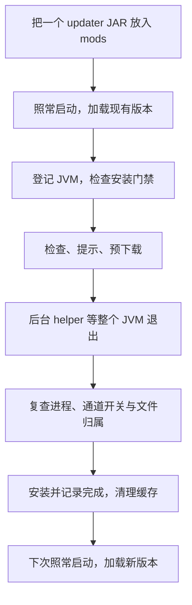

<p align="center"></p>

<h1 align="center">Folkways Updater</h1>

<p align="center">放入一个 Mod，更新留给退出之后。</p>

<p align="center">
  <a href="https://github.com/davisye/update-folkways/actions/workflows/ci.yml"></a>
  
  
  <a href="LICENSE"></a>
</p>

<p align="center">
  <a href="#快速开始">快速开始</a> ·
  <a href="https://github.com/davisye/update-folkways/releases">下载</a> ·
  <a href="docs/configuration.md">配置</a> ·
  <a href="docs/verification.md">验证范围</a> ·
  <a href="docs/plan.md">路线图</a> ·
  <a href="#english">English</a>
</p>

面向 [Folkways](https://github.com/IzakyL/folkways) 开发版的独立 NeoForge 1.21.1 更新器。**新安装只需一个 Mod JAR**：运行时检查、提示和预下载，后台 helper 等整个游戏 JVM 退出后安装，下次启动加载新版本。无需手动安装 Bootstrap、启动脚本、更新元数据或密钥。

> **开发预览。** 第一次运行加载当前已安装的版本，下载准备给退出后安装；不承诺每次启动前一定是最新。默认从所选仓库的官方 GitHub Release 安装或更新 Folkways，无需填写签名密钥。独立签名清单仍是可选通道，其公共自动签名发布尚未启用。

## 快速开始

1. 安装 Java 21 与 Minecraft 1.21.1 / NeoForge **21.1.233 或更新版本**，关闭准备使用的实例。
2. 从 [Releases](https://github.com/davisye/update-folkways/releases) 下载 **`folkways-updater-neoforge-1.21.1-<version>.jar`**，放进实例 `mods/`。只保留一份 updater。
3. 照常启动。空实例默认检查并预下载 Folkways **Core、Vanilla 和缺失的 LDLib2**；正常退出整个游戏，等待后台 helper 安装，再次启动后加载。

更新 helper 已包含在 Mod 内，会自动释放到实例的 `.folkways-updater/`。不必更换启动器或复制额外脚本。Minecraft、NeoForge 仍需先安装；在配置页勾选 Create、Modular Golems、Cookery 后，会一并预下载缺失的官方前置及必要依赖。

在 NeoForge **Mods → Folkways Development Updater → 配置** 中选择源、渠道和模块，或开启本地开发保护。点击检查会先保存，再后台检查；主菜单也能看到状态与下载提示，不必先进入世界。

国内可先在官方 Release 确认同次发布的 JAR 文件名，再使用同附件镜像：

```text
https://github.davisye.cn/_github/github.com/davisye/update-folkways/releases/download/nightly/<完整JAR文件名>
```

首次手工下载仍由你确认可信来源。镜像负责传输，自动更新的信任依据来自官方 GitHub API 与成功 CI 构建。具体安装、退出和异常恢复说明见 [安装指南](docs/installation.md)。已有 Bootstrap/seed 用户请看其中的 [旧方式迁移](docs/installation.md#旧-bootstrapseed-方式迁移)。

## 一次更新的节奏



运行中不覆盖已加载的 JAR。若你重开游戏恰好与安装重叠，安装门禁可能中止这次启动并提示重开，避免混代文件进入世界。Mod 构造阶段已经晚于部分加载器扫描；本项目不把这称为“扫描前更新”。[架构与边界](docs/audit.md) 说明了选择这个流程的原因。

## 两个独立的更新开关

本地开发按钮只读取配置 `localDevelopment`。新配置默认 `false`，已有配置保留原值；源码构建、IDE、JVM 参数、环境变量和旧 `LOCAL_DEVELOPMENT` 文件都不会自动打开它。

| 设置 | 作用 |
| --- | --- |
| `localDevelopment=true` | 暂停 Folkways 和依赖的检查、预下载、安装与恢复写入，保留本地编译的 Folkways |
| `selfUpdateEnabled=true` | 独立启用更新器自身更新；本地开发开启时仍可检查、预下载，并在退出后安装或恢复 |

要同时保留自己编译的 updater，将 `selfUpdateEnabled` 设为 `false`。IDE 中没有已安装 updater JAR 时，自更新没有可替换目标；这不会自动改变本地开发开关。

两个通道仍分别核对文件归属和来源。已登记 updater 仅改名且字节相同时可安全重绑定；手动换入官方新版后，校验官方摘要与 CI 身份才能恢复自身托管。这个校验不可用时，不会顺带关闭 Folkways。完整说明见 [配置指南](docs/configuration.md)。

## 更新来源与模块

| 通道 | 信任与当前边界 |
| --- | --- |
| 更新器自身 | 固定 `davisye/update-folkways`；官方 API 的资产大小/SHA256、成功 `ci.yml` 构建、完整提交和 JAR 内构建身份一致才接受；无需配置 Folkways 签名密钥 |
| Folkways 默认来源 | 可选 `IzakyL/folkways` 或 `davisye/folkways`；核对官方 Release 资产摘要、固定提交和对应成功发布 CI，无需填写密钥 |
| Folkways 可选签名来源 | 配置非空 `manifestUrl` 与可信 Ed25519 公钥后使用；公共自动签名发布尚未启用 |

Core、Vanilla 必选，Create、Modular Golems、Cookery 按需选择，同一次更新来自同一构建。基础安装需要的外置库是 LDLib2；选择可选扩展时，会补齐缺失的 Create、Modular Golems、Kaleidoscope Cookery，以及必要的 L2Library。Ponder、Flywheel、Starlark 等内嵌库不重复安装。已有兼容前置只读复用，版本冲突时提示并保留原文件。具体固定版本和官方来源见 [前置安装规则](docs/dependencies.md)。

`manifestUrl` 留空即使用官方 GitHub 来源，不表示关闭 Folkways 更新。首次自动安装只接管没有 Folkways 的空集合；已有手动或本地编译的 Folkways JAR 不被静默接管。release、rc、beta、alpha、nightly 是可选渠道，当前两源实际只有 nightly；没有符合条件的发行时保留当前文件。

网络新配置默认 `mirror-first`，GitHub 下载与 [github.davisye.cn](https://github.davisye.cn/) 可故障切换。`region` 策略使用本地 `regionHint=CN`，不查询 IP 地域。Windows 建连失败时可回退到已启用的静态系统 HTTP 代理，无需额外启动参数。可信元信息来自官方 API；不可用时保留现有文件。SHA256 校验不是数字签名，成功 CI 记录也不是签名证明。

[OpenList](https://pan.davisye.cn/) 可展示 Folkways 发布链接。[主机侧自动同步](docs/openlist-sync.md) 每十分钟检查两个仓库，只更新各自已完成发布的 nightly 外链，并保留其他目录；JAR 继续由国内镜像分发。其他渠道按版本归档；外链目录不等于持久二进制存储。发布工具和存储边界见 [发布镜像指南](docs/publishing.md)。

## 游戏内命令

命令需要 OP 4。状态和检查可用；停止/重启类命令还要求 `commandsEnabled=true`，默认关闭。

| 命令 | 行为 |
| --- | --- |
| `/folkwaysupdate status` | 查看状态 |
| `/folkwaysupdate check` | 后台检查和预下载；两个更新通道分别遵守各自开关 |
| `/shutdown [seconds]` | 默认 10 秒，范围 0–300 秒；正常停止和存档，集成服务器随后关闭客户端 |
| `/shutdown cancel` / `/restart cancel` | 停止请求发出前取消倒计时 |
| `/restart [seconds]` | 专服正常停止后，由 helper 重新启动整个 Java 进程；支持同样的倒计时与取消 |

Drop-in `/restart` 已在只安装 updater 的真实 NeoForge 专服中验证正常保存、整 JVM 重启、原世界重开，以及限额拒绝后保持运行。helper 或原始参数不可用时先拒绝请求；完整 Folkways 包、真实玩家及客户端尚未测试。完整客户端重启暂未接入启动器，不能用重启集成服务器代替。当前边界见 [验证说明](docs/verification.md)。

## 开发与验证

```powershell
.\gradlew.bat build --console=plain
python -m unittest discover -s tests/publisher -v
```

Linux 使用 `./gradlew`。需要 Java 21 JDK、Python 3.11+；首次构建会下载依赖。开发时请显式设置 `localDevelopment=true`；若也要保留自己编译的 updater，再设 `selfUpdateEnabled=false`。[贡献指南](CONTRIBUTING.md) 说明如何使用隔离测试实例。

Windows/Linux [CI](https://github.com/davisye/update-folkways/actions/workflows/ci.yml)、实际单 JAR 安装验证、历史外部 seed 升级实验的范围分开记录在 [验证说明](docs/verification.md)，不把旧方式成功等同新方式已验收。

## 继续阅读

- [安装](docs/installation.md) · [配置](docs/configuration.md) · [架构](docs/audit.md)
- [验证](docs/verification.md) · [路线图](docs/plan.md) · [CI](docs/ci.md)
- [贡献](CONTRIBUTING.md) · [安全报告](SECURITY.md) · [变更记录](CHANGELOG.md)

遵循 [MIT 许可证](LICENSE)，第三方组件见 [THIRD_PARTY.md](THIRD_PARTY.md)。本项目是独立开发工具，未与 Minecraft、NeoForge 或 Folkways 上游建立官方隶属关系。

## English

Drop one updater JAR into `mods/` and launch NeoForge 1.21.1 normally. The mod checks and stages downloads, then an embedded helper waits for the entire game JVM to exit before installing. The next launch loads the installed version; this does not guarantee the newest release before every startup scan.

The default source installs Folkways Core, Vanilla, and missing LDLib2 from verified official release metadata; no signing keys are required. Optional Create, Modular Golems and Cookery integrations can be selected before their prerequisites are installed: missing audited prerequisites and required transitive dependencies are staged together. Compatible existing files are reused; conflicting manual files are retained. Only `config.localDevelopment` pauses Folkways and dependency updates. Updater self-updates use the independent `selfUpdateEnabled` switch and continue in local-development mode. IDEs, source identity, environment variables, JVM flags, and legacy marker files do not enable that mode. Manually installed Folkways is not silently adopted. A nonempty manifest URL selects the optional signed channel; public automatic signing remains deferred.

See [installation](docs/installation.md), [configuration](docs/configuration.md), and [verification limits](docs/verification.md). Drop-in restart was tested on an isolated NeoForge dedicated server with only this mod; a full Folkways pack, human players, and the Minecraft client were not tested. Full client restart remains unsupported.
